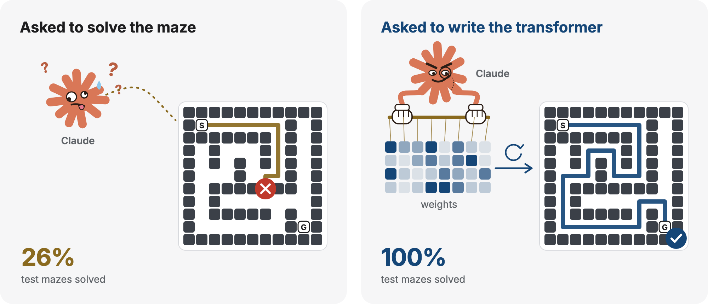

<h1 align="center">Looped Weight-Space Programming: LLM-Written Transformers for Long Algorithmic Reasoning</h1>

<p align="center">
  <a href="https://python-arch.github.io/">Abdelrahman Elsayed</a>*,
  <a href="https://ahmedheakl.github.io/">Ahmed Heakl</a>*,
  <a href="https://amshaker.github.io/">Abdelrahman Shaker</a>,
  <a href="https://sites.google.com/view/fahadkhans">Fahad Khan</a>,
  <a href="https://salman-h-khan.github.io/">Salman Khan</a>,
  <a href="https://www.anthropic.com/claude">Claude Opus 5.5</a>
  <br>
  <sub>* Equal contribution</sub>
</p>

<p align="center">
  <a href="https://mbzuai.ac.ae/"><picture><source media="(prefers-color-scheme: dark)" srcset="assets/mbzuai_logo_dark.svg"></picture></a>
</p>

<p align="center">
  <a href="https://python-arch.github.io/written-not-trained/"><b>Read the blog post</b></a>
  &nbsp;·&nbsp;
  <a href="https://python-arch.github.io/written-not-trained/demo/maze.html">Maze demo</a>
  &nbsp;·&nbsp;
  <a href="https://python-arch.github.io/written-not-trained/demo/index.html">Tower of Hanoi demo</a>
</p>

<p align="center">
  
</p>

Claude Opus 5.5 set every weight of a small looped transformer by hand, with no training. That transformer solves 100% of the test mazes in [Maze-Hard](https://huggingface.co/datasets/sapientinc/maze-30x30-hard-1k), a benchmark of 30×30 mazes whose shortest paths run longer than 110 steps. When Claude is asked for the paths directly, it solves only 26% of them.

The transformer is a single block with 19,936 weights. What lets it solve mazes this hard is a loop. Each pass through the block moves a shortest-path search one step further, so a bigger maze needs more passes rather than more weights. The same weights solve 100% of the mazes we generated at 60×60 and at 100×100, even though Claude tested the transformer only on 30×30 mazes. We call this approach *looped weight-space programming*. Claude used it to write transformers for other hard tasks too, from Sudoku-Extreme to a 20-disk Tower of Hanoi. Each of them scores 100% on its test problems.

## Results

| Task | The transformer Claude wrote | What we compare with |
|---|---|---|
| **Maze-Hard** (30×30 mazes) | **100%** with 19,936 weights | LDT (trained, 1.8M weights) 99.8%<br>Claude Opus 5.5 26% |
| **Sudoku-Extreme** | **100%** of the puzzles we ran | Sotaku v2 (trained) 98.96% |
| **GraphWalks** (prompts of up to 1M tokens) | **100%** F1 | Gemini 4 Carbon 96.2% |
| **Graph search**, routes longer than Claude checked | **100%** with 6,966 weights | 0% for trained models up to 99× bigger |
| **Parity**, strings longer than Claude checked | **100%** at every length tried, up to 4,095 bits | Trained models fall to chance (45.5–53.8%) |
| **Reasoning chains**, longer than Claude checked | **100%** at 12 to 32 steps | The best trained model drops to 3.5% |
| **Boolean Expressions** (BIG-Bench Hard) | **100%** | SmolLM2-360M 69.6% |
| **Dyck Languages** (BIG-Bench Hard) | **100%** | Pythia-410M 33.2% |
| **Web of Lies** (BIG-Bench Extra Hard) | **100%** | Qwen3-235B-A22B 81.2% |
| **Shuffled Objects** (BIG-Bench Extra Hard) | **100%** | Qwen3-235B-A22B 56.9%, by writing a program |
| **Tower of Hanoi**, 20 disks | **1,048,575 moves, zero mistakes** | MAKER needed over 3 million LLM calls |
| **Checker Jumping**, up to 40 per side | **The fewest possible moves at every size** | Claude 3.7 Sonnet Thinking and DeepSeek-R1 fail from about 3 per side |

As a side result, Claude also found why Ouro-1.4B, a looped language model trained by others, gets worse when it runs extra loops. Its fix needs no training and lifts Ouro from 66.6% to 75.2% on GSM8K at 8 loops. The blog post covers every result in full, together with how each number was measured.

## Run the weights

The `weights/` folder holds ten of the transformers together with `run.py`, one short script that runs any of them. It needs only Python 3 and numpy.

```bash
cd weights
python run.py maze --random 30
python run.py hanoi 10
```

Each command prints the answer and checks it. [`weights/README.md`](weights/README.md) shows how to run all ten.

## Prompts

The [`prompts/`](prompts/) folder holds the first message Claude received in each experiment, word for word. That includes the task descriptions for writing each transformer, the prompts behind Table 1 of the blog post and the prompt for writing the whole maze transformer in one answer. [`prompts/README.md`](prompts/README.md) says which file belongs to which result.

## Credits

This work builds on [Weight-Space Programming](https://rikiyat.github.io/blog/weight-space-programming/) (Takehi, Teoh, Zhang and Khattab, MIT CSAIL, 2026). Maze-Hard and Sudoku-Extreme come from the [HRM paper](https://arxiv.org/abs/2506.21734) (Wang et al.), BIG-Bench Hard from Suzgun et al. and BIG-Bench Extra Hard from Kazemi et al. The Tower of Hanoi and Checker Jumping puzzles follow [The Illusion of Thinking](https://arxiv.org/abs/2506.06941) (Shojaee et al., 2025). The blog post lists all related work.

## Citation

If you use this work, please cite it as follows.

```bibtex
@misc{elsayed2026written,
  title        = {{Looped Weight-Space Programming: LLM-Written Transformers for Long Algorithmic Reasoning}},
  author       = {Elsayed, Abdelrahman and Heakl, Ahmed and Shaker, Abdelrahman and Khan, Fahad and Khan, Salman and {Claude Opus 5.5}},
  year         = {2026},
  month        = nov,
  howpublished = {\url{https://python-arch.github.io/written-not-trained/}},
  note         = {Blog post}
}
```

## License

Everything in this repository and on the blog, including the code, weights, text, figures and animations, is released under the [MIT license](LICENSE).
